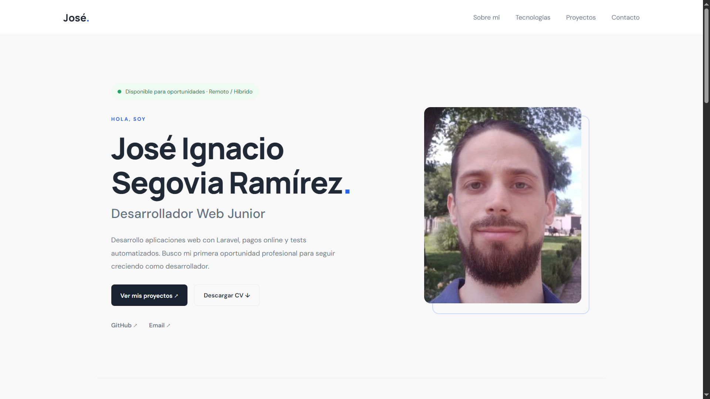

# Portfolio – José

Portfolio personal de desarrollador web, creado para presentar mi perfil profesional, las tecnologías con las que trabajo y los proyectos que he desarrollado durante mi formación y experiencia práctica.

🌐 **Portfolio online:** https://mi-portfolio-niwg.onrender.com/

## 📸 Vista previa



## 🚀 Tecnologías utilizadas

El proyecto está desarrollado utilizando las siguientes tecnologías:

### Front-end
- HTML5
- CSS3
- JavaScript
- React
- Bootstrap

### Herramientas
- Git
- GitHub
- Vite

## ✨ Características

- Diseño moderno, minimalista y adaptable a diferentes dispositivos.
- Sección de presentación personal.
- Apartado de tecnologías y herramientas.
- Galería de proyectos desarrollados.
- Información de contacto y enlaces profesionales.
- Navegación sencilla e intuitiva.

## 💻 Instalación y ejecución

Si quieres ejecutar el proyecto en tu entorno local, sigue estos pasos:

**1. Clonar el repositorio**

```bash
git clone https://github.com/joseignaciosegovia/portfolio.git
```

**2. Acceder al directorio**

```bash
cd portfolio
```

**3. Instalar las dependencias**

```bash
npm install
```

**4. Iniciar el servidor de desarrollo**

```bash
npm run dev
```

## 📦 Compilación para producción

Para generar la versión optimizada del proyecto:

```bash
npm run build
```

Los archivos generados estarán disponibles en el directorio `dist/`.

## ☁️ Despliegue

El portfolio está preparado para desplegarse en [Render](https://render.com/) como un sitio estático.

Configuración de despliegue:

- **Build Command:** `npm install && npm run build`
- **Publish Directory:** `dist`

## 📬 Contacto

Si quieres contactar conmigo o conocer más sobre mi trabajo:

- **GitHub:** [joseignaciosegovia](https://github.com/joseignaciosegovia)
- **Email:** [josegoviaramirez@gmail.com](mailto:josegoviaramirez@gmail.com)

---

Desarrollado por **José**.